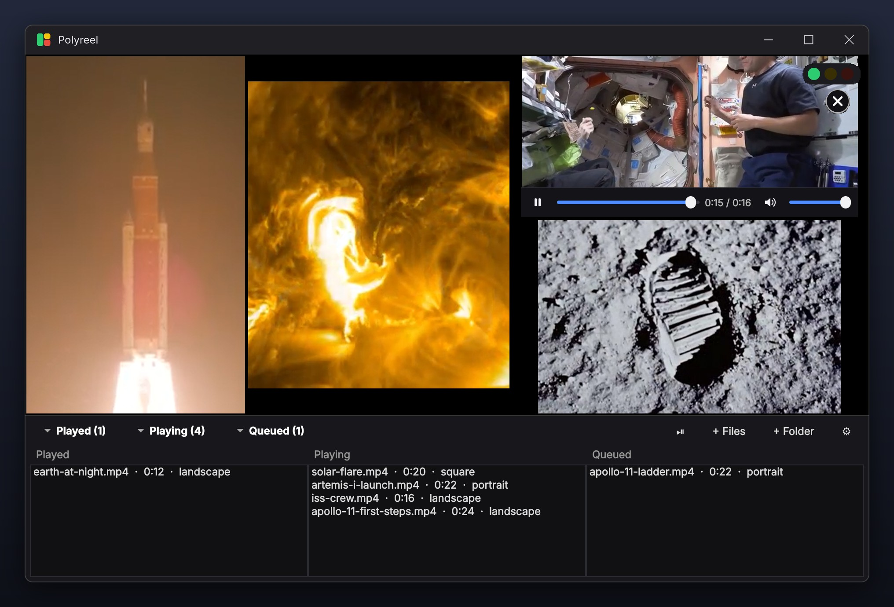

# Polyreel



Play a whole folder of videos **at the same time**, packed into one window like a
masonry wall. Landscape, portrait, square and ultrawide videos all keep their shape
and stay roughly the same size, fitted together like puzzle pieces to fill the window.

- **Smart packing.** Videos are arranged in nested rows and columns that line up
  edge to edge, and no video is allowed to dominate: sizes stay within about 1.5x
  of each other. Videos are always shown whole by default; space they can't fill
  becomes an even border around the wall, or thin bars inside a few tiles when
  that lets the wall fill much more of the window. If you'd rather have less black,
  *Crop edges to fill gaps* lets videos be enlarged to fill their tiles, trimming
  a little off their edges (up to the percentage you choose). A search (seeded with
  justified rows/columns, refined by simulated annealing) finds the arrangement
  that shows the most picture while avoiding big bars on any one video. When one
  video ends, its replacement takes over the same spot, so the rest of the wall
  doesn't jump around.
- **Your limits.** *Max simultaneous videos* and *Smallest video size* (as a % of
  the window area). Videos that would break either limit wait in the queue.
  The first time you add videos, an optional **benchmark** plays your own files
  several at a time and recommends the highest count with no dropped frames. It
  starts at 8, doubles while that plays smoothly and narrows in once it doesn't,
  so it needs only 3 to 5 measurements (about half a minute).
- **Performance traffic light** in a window corner (and the system tray):
  green = smooth, yellow = some frames dropped (≥1%), red = struggling (≥5%).
  Hover it for numbers; click it for settings.
- **Click a video to focus it.** Everything else pauses, the video fills the window,
  and when it finishes the wall comes back and resumes. Click again or press Esc to
  return early.
- **Three playlists.** Move the mouse to the bottom edge to reveal
  *Played*, *Playing* and *Queued*. Click one to open it: the playlists dock below
  the wall, which shrinks to fit above them; close them all to get the full
  window back. Drag to reorder the queue, double-click to play next / focus /
  replay, right-click for more, Delete to remove.
- **Hover controls.** Hovering over a video shows a seek bar, play/pause, its time
  and its own volume and mute along the bottom, plus a **✕** in the corner that
  moves it straight to *Played* (the next queued video takes its place).
- **Endless playback** (optional): when the queue runs out, everything already
  played is queued again, so the wall never empties.
- **Sound modes.** *Video under the mouse* (default): everything is muted except
  the video you hover, at its own volume, plus any video whose volume you've
  changed (or unmuted) with its own controls, which keeps playing aloud. *All videos at once*: new videos start
  at full volume. *Silent*: new videos start muted. In every mode a video's own
  mute and volume controls win. Press **M** to switch.
- **Video only.** Folders are scanned for video files; animated GIFs and PNGs
  count, still images (GIF, PNG, JPEG, WebP…) and audio-only files are skipped.

## Download (Windows)

Get `Polyreel-<version>-windows-x64.zip` from the
[Releases page](https://github.com/alamone/polyreel/releases), unzip it anywhere and
run **`Polyreel.exe`**. Everything it needs is inside the folder; there is nothing
to install.

Polyreel isn't code-signed, so the first time Windows may show *"Windows protected
your PC"*. Click **More info → Run anyway**.

## Running from source

Requires Python 3.10+ and **libmpv**.

```bash
pip install -r requirements.txt
python -m polyreel [video files or folders...]
```

### Windows: getting libmpv

1. Download the latest `mpv-dev-x86_64-v3-*.7z` (or `mpv-dev-x86_64-*.7z` for older CPUs) from
   <https://github.com/shinchiro/mpv-winbuild-cmake/releases>.
2. Extract **`libmpv-2.dll`** (7-Zip can open the archive) into this folder,
   next to `README.md`, or into a `lib\` subfolder.
3. Double-click `run.bat`. On first run it installs the Python packages
   (`pip install -r requirements.txt`) for you, and it tells you if the DLL is missing.

### Linux / macOS

- Debian/Ubuntu: `sudo apt install libmpv2` (or `libmpv-dev`)
- Fedora: `sudo dnf install mpv-libs`
- macOS: `brew install mpv`

### Building the Windows zip

The [Windows build workflow](.github/workflows/windows-build.yml) builds it on GitHub:
pushing a tag such as `v0.1.0` builds the zip and publishes a release, and running the
workflow by hand from the Actions tab builds a test zip without releasing. To build
locally, put `libmpv-2.dll` in the project root and run
`pip install pyinstaller` then `pyinstaller --noconfirm packaging/polyreel.spec`;
the result is in `dist\Polyreel`.

## Controls

| | |
|---|---|
| Click a video | Focus it (pause others, fill the window) / click again to go back |
| Hover a video | Seek bar, play/pause, volume and mute for that video |
| ✕ on a video (on hover) | Move it to *Played* now |
| Right-click | Menu: focus, skip, add, settings, benchmark |
| Mouse at bottom edge | Show the playlist bar; click a list to dock it open |
| Space | Pause / resume all |
| F, F11, double-click empty space | Fullscreen |
| Esc | Leave focus → leave fullscreen; cancels a running benchmark |
| N | Skip the video under the mouse |
| M | Switch sound mode (under the mouse → all → silent) |
| O / Ctrl+O | Add files / add a folder (or drag & drop onto the window) |
| Ctrl+, | Settings |

## Settings

| Setting | Meaning |
|---|---|
| Max simultaneous videos | Hard cap on concurrent streams. Use **Benchmark…** to measure. |
| Smallest video size | No video is shrunk below this % of the window area (25% ≈ 2×2 grid, 11% ≈ 3×3, 6% ≈ 4×4, 4% ≈ 5×5). |
| Queue look-ahead | 1 = strict queue order. N > 1 lets one of the next N videos jump ahead if its shape fits the free space better. |
| Crop edges to fill gaps | How much of a video's width or height may be trimmed so it fills its tile. Default 0%: videos are always shown whole, with black bars where needed. |
| Sound | Video under the mouse / All videos at once / Silent (see above). |
| Hardware decoding | `auto-safe` (default) offloads decoding to the GPU, which allows far more streams. |
| Endless playback | When the queue runs out, queue everything already played again. |
| Gap, shuffle, light position, tray icon | As named. |

## Project layout

```
polyreel/
  layout.py     aspect-preserving packing (pure Python, unit tested)
  scheduler.py  which videos start / wait / get bumped (pure Python, unit tested)
  playlist.py   played / playing / queued lists
  perf.py       frame-drop monitor, traffic-light levels, benchmark plan
  tile.py       one libmpv player embedded in a native child window
  probe.py      background probing of each file's shape and length
  ui.py         playlist drawer, traffic light and close-button widgets
  app.py        main window tying it together
tests/          pytest suite for the pure-Python parts
```

Run the tests with `pip install pytest && python -m pytest`.

## Notes

- Each video is its own libmpv instance rendering into a native child window,
  so decoding and rendering stay in mpv (hardware-accelerated) and any video
  format mpv can decode plays.
- Overlays (the playlist drawer, the light, the ✕) are native windows stacked above the
  videos; they are opaque rather than translucent for that reason.
- The benchmark uses your own files, because a 4K HEVC file and a 480p H.264 file
  cost very different amounts to decode. Re-run it if your library changes.

## Credits

Screenshots show public-domain footage from the
[NASA Image and Video Library](https://images.nasa.gov/): the Artemis I launch,
Apollo 11 on the Moon, life aboard the International Space Station, Earth at
night from orbit, a solar flare seen by the Solar Dynamics Observatory, and a
timelapse inside Kennedy Space Center's Vehicle Assembly Building.
NASA does not endorse this project.

## License

Copyright (C) 2026 alamone

Polyreel is free software: you can redistribute it and/or modify it under the terms of
the [GNU General Public License](LICENSE), version 3 or (at your option) any later
version. It comes with no warranty.

Additional terms (GPLv3 section 7): the license grants no rights to use the name
"Polyreel" or its icon, and modified versions must be clearly marked as different from
the original, including by not being called "Polyreel".

The Windows download bundles libmpv (GPL), Qt/PySide6 (LGPL), python-mpv and Python;
see `THIRD-PARTY-NOTICES.txt` in the zip for their licenses and sources.
