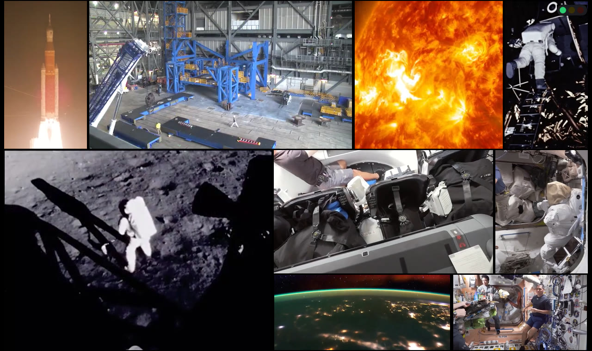
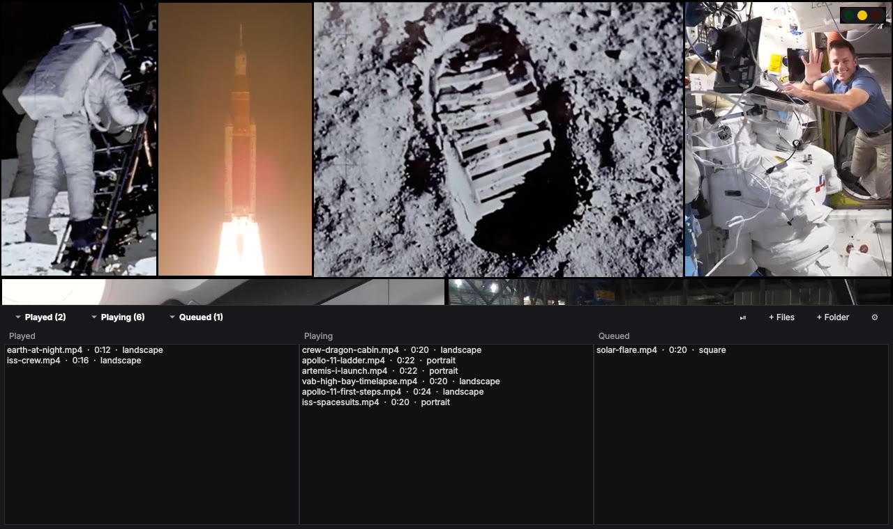

# Polyreel



Play a whole folder of videos **at the same time**, packed into one window like a
masonry wall. Landscape, portrait, square and ultrawide videos all keep their shape;
the layout engine fits them together like puzzle pieces so as little of the screen
as possible is wasted.

- **Smart packing.** Every layout is a guillotine tiling where each video keeps its
  aspect ratio, so the only wasted space is an outer letterbox. A search
  (seeded with justified rows/columns, refined by simulated annealing) picks the
  arrangement that fills the window best while keeping tile sizes even. When one
  video ends, its replacement takes over the same spot if the shape is similar,
  so the rest of the wall doesn't jump around.
- **Your limits.** *Max simultaneous videos* and *Smallest video size* (as a % of
  the window area). Videos that would break either limit wait in the queue.
  The first time you add videos, an optional **benchmark** plays your own files
  at 1, 2, 3, 4, 6, 8… at once and recommends the highest count with no dropped frames.
- **Performance traffic light** in a window corner (and the system tray):
  green = smooth, yellow = some frames dropped (≥1%), red = struggling (≥5%).
  Hover it for numbers; click it for settings.
- **Click a video to focus it.** Everything else pauses, the video fills the window,
  and when it finishes the wall comes back and resumes. Click again or press Esc to
  return early.
- **Three hidden playlists.** Move the mouse to the bottom edge to reveal
  *Played*, *Playing* and *Queued*; click each to expand it. Drag to reorder the
  queue, double-click to play next / focus / replay, right-click for more, Delete to remove.

  

- Sound follows the mouse (the video under the pointer is unmuted); optional.

## Running it

Requires Python 3.10+ and **libmpv**.

```bash
pip install -r requirements.txt
python -m polyreel [video files or folders...]
```

### Windows: getting libmpv

1. Download the latest `mpv-dev-x86_64-v3-*.7z` (or `mpv-dev-x86_64-*.7z` for older CPUs) from
   <https://github.com/shinchiro/mpv-winbuild-cmake/releases>.
2. Extract **`libmpv-2.dll`** (7-Zip can open the archive) into this folder,
   next to `README.md`, or into a `lib\` subfolder.
3. Double-click `run.bat`, or run `python -m polyreel`.

### Linux / macOS

- Debian/Ubuntu: `sudo apt install libmpv2` (or `libmpv-dev`)
- Fedora: `sudo dnf install mpv-libs`
- macOS: `brew install mpv`

## Controls

| | |
|---|---|
| Click a video | Focus it (pause others, fill the window) / click again to go back |
| Right-click | Menu: focus, skip, add, settings, benchmark |
| Mouse at bottom edge | Show the playlists |
| Space | Pause / resume all |
| F, F11, double-click empty space | Fullscreen |
| Esc | Leave focus → leave fullscreen; cancels a running benchmark |
| N | Skip the video under the mouse |
| O / Ctrl+O | Add files / add a folder (or drag & drop onto the window) |
| Ctrl+, | Settings |

## Settings

| Setting | Meaning |
|---|---|
| Max simultaneous videos | Hard cap on concurrent streams. Use **Benchmark…** to measure. |
| Smallest video size | No video is shrunk below this % of the window area (25% ≈ 2×2 grid, 11% ≈ 3×3, 6% ≈ 4×4, 4% ≈ 5×5). |
| Queue look-ahead | 1 = strict queue order. N > 1 lets one of the next N videos jump ahead if its shape fits the free space better. |
| Hardware decoding | `auto-safe` (default) offloads decoding to the GPU, which allows far more streams. |
| Gap, repeat all, shuffle, light position, tray icon | As named. |

## Project layout

```
polyreel/
  layout.py     aspect-preserving packing (pure Python, unit tested)
  scheduler.py  which videos start / wait / get bumped (pure Python, unit tested)
  playlist.py   played / playing / queued lists
  perf.py       frame-drop monitor, traffic-light levels, benchmark plan
  tile.py       one libmpv player embedded in a native child window
  probe.py      background probing of each file's shape and length
  ui.py         playlist drawer and traffic-light widgets
  app.py        main window tying it together
tests/          pytest suite for the pure-Python parts
```

Run the tests with `pip install pytest && python -m pytest`.

## Notes

- Each video is its own libmpv instance rendering into a native child window,
  so decoding and rendering stay in mpv (hardware-accelerated) and every format
  mpv supports works.
- Overlays (the playlist drawer, the light) are native windows stacked above the
  videos; they are opaque rather than translucent for that reason.
- The benchmark uses your own files, because a 4K HEVC file and a 480p H.264 file
  cost very different amounts to decode. Re-run it if your library changes.

## Credits

Screenshots show public-domain footage from the
[NASA Image and Video Library](https://images.nasa.gov/): the Artemis I launch,
Apollo 11 on the Moon, life aboard the International Space Station, Earth at
night from orbit, a solar flare seen by the Solar Dynamics Observatory, and a
timelapse inside Kennedy Space Center's Vehicle Assembly Building.
NASA does not endorse this project.
